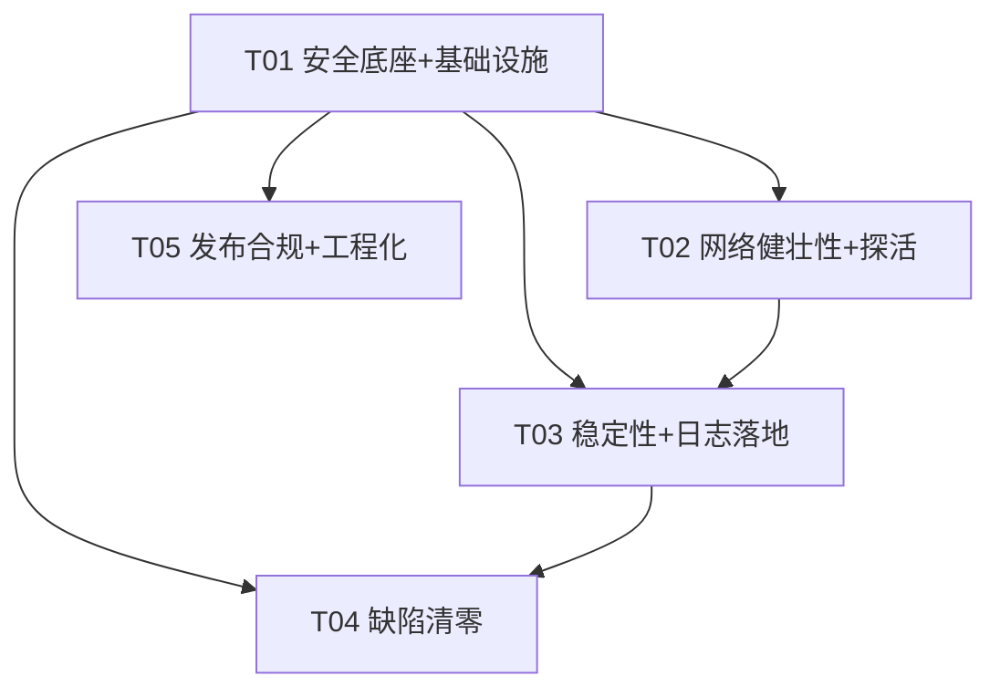

# BBPlayer Desktop 生产级加固 · 系统设计与任务分解

> 架构师：高见远（Gao）
> 上游输入：`docs/PRD-hardening.md`（H-01~H-21 + 10 项安全基线，产品经理已确认）
> 现状基线：`docs/ARCHITECTURE.md`（MVP 架构，已交付）
> 下游交付：工程师寇豆码的实现执行清单
> 本文档为**增量设计**：仅描述「加固变更」，不重复 MVP 既有功能。

---

## 0. 文档导读

| 章节 | 内容 | 目标读者 |
|---|---|---|
| 1 | 加固总体方案（五层模型） | 全体 |
| 2 | P0 需求逐项落地方案（H-01~H-12） | 工程师 |
| 3 | P1/P2 方案（H-13~H-21） | 工程师 |
| 4 | 新增/修改文件清单（精确到相对路径） | 工程师 |
| 5 | 依赖包新增清单（含版本与选型理由） | 工程师 |
| 6 | 任务列表（有序、含依赖与验收标准） | 工程师 |
| 7 | 共享知识更新（跨文件约定） | 工程师 |
| 8 | 待明确事项 | 产品/主理人 |

---

## 1. 加固总体方案

### 1.1 五层加固模型

```
┌────────────────────────────────────────────────────────────┐
│ 发布合规层  H-15 依赖审计 / H-16 自动更新 / H-17 签名公证    │
│            H-18 隐私政策与免责声明 / H-19 Sentry / H-21 CI   │
├────────────────────────────────────────────────────────────┤
│ 工程化层    H-20 多语言 i18n / 统一日志 / 单测门禁           │
├────────────────────────────────────────────────────────────┤
│ 稳定性层    H-06 全局异常兜底 / H-07 ErrorBoundary           │
│            H-08 结构化日志 / render-process-gone 恢复        │
├────────────────────────────────────────────────────────────┤
│ 网络层      H-04 Cookie 过期检测 / H-05 超时与取消           │
│            H-13 有限重试 / H-14 并发限流                     │
├────────────────────────────────────────────────────────────┤
│ 安全层      H-01 渲染沙箱 / H-02 CSP / H-03 导航/窗口/权限   │
│            基线#7 敏感数据 / #8 preload 最小化 / #9 IPC 校验  │
└────────────────────────────────────────────────────────────┘
```

### 1.2 关键设计决策（已纳入主理人 8 项拍板）

| # | 决策 | 落地位置 |
|---|---|---|
| 1 | 短信登录不接 geetest，保留占位 | `auth.ts` / `ipc/bilibili.ts` 维持现状 |
| 2 | Sentry 仅 P2 预留框架（DSN 注入 + 开关 + 采样，不接真实 DSN） | `src/main/sentry.ts` |
| 3 | electron-updater 本期接入（校验/回退）；签名/公证配置预留 | `src/main/updater.ts` + `electron-builder.yml` |
| 4 | 多语言首发中英双语 | `src/renderer/src/i18n/*` |
| 5 | Cookie 过期 → 强制重登（清 Cookie + UI 提示），不做只读 | `auth.ts` `verifySession()` |
| 6 | CSP `script-src 'self'` 严格；`style-src` 保留 `'unsafe-inline'` | `src/shared/security.ts` |
| 7 | render-process-gone → 自动 reload 一次 + 结构化日志 | `src/main/index.ts` |
| 8 | 更新源 GitHub Releases，预留 OSS/CDN 扩展 | `electron-builder.yml` `publish.provider: github` |

### 1.3 加固技术难点与框架选型

| 难点 | 选型 | 理由 |
|---|---|---|
| 结构化日志 | **electron-log@^5** | 纯 JS（无原生模块），主进程文件落盘 + 滚动截断，渲染进程经 IPC 汇入同一文件；不引入 better-sqlite3 之外的原生模块重编译负担 |
| 崩溃上报（P2） | **@sentry/electron@^5** | 主/渲染双端 + 原生 crashpad；⚠️ 含原生崩溃处理器，接入后需 `electron-builder install-app-deps` 重编译并匹配 Electron ABI |
| 自动更新 | **electron-updater@^6** | 与 electron-builder 24 同源，签名校验/差分更新/失败不损坏安装开箱即用 |
| 多语言 | **i18next@^23 + react-i18next@^15** | 生态事实标准，React 18 兼容 |
| 超时/重试/限流 | 自研 `fetch-utils.ts` + `rate-limiter.ts` | 主进程全量 HTTP 收敛到原生 fetch 封装，不引入 axios，避免额外依赖面 |

**重要约束（原生模块与 Electron 版本匹配）**：
- 现状原生模块仅 `better-sqlite3@^11`，由 `postinstall: electron-builder install-app-deps` 针对 Electron 31 的 ABI 重编译。
- 新增依赖中 **electron-log / electron-updater / i18next / react-i18next 均为纯 JS**，不新增原生重编译负担。
- **@sentry/electron（P2）含原生崩溃处理器**，接入时须确保其预编译二进制与 Electron 31 ABI 匹配，并在 `package.json` 保留 `postinstall` 重编译钩子；如 DSN 未就绪，保持「代码就位、默认关闭」，不引入运行时开销。

---

## 2. P0 需求逐项落地方案（H-01 ~ H-12）

### H-01 渲染进程开启沙箱

**改动文件**：`src/main/window-manager.ts`

**方案**：
1. 主窗口（约 41 行）与歌词窗口（约 90 行）`webPreferences.sandbox: false` → `sandbox: true`。
2. 沙箱化 preload 约束：`sandbox: true` 下 preload 只能 `require('electron')`（`contextBridge`/`ipcRenderer`），**不能 require Node 内置模块或外部 npm 包**。当前 `preload/index.ts` 仅从 `electron` 取 `contextBridge/ipcRenderer`，`IPC` 常量与类型经 electron-vite 打包内联（`shared/ipc.ts` 是源码非依赖），因此**无需改造构建**即可兼容。
3. 保留 `contextIsolation: true` + `nodeIntegration: false`（基线#2 现状已满足）。

**验收**：两窗口 `sandbox` 均为 `true`；dev/prod 全量功能可用；无「preload 中 require 受限」类报错。

---

### H-02 CSP 加固

**改动文件**：`src/shared/security.ts`（新增，策略唯一来源）、`src/main/security.ts`（新增，响应头注入）、`src/renderer/index.html`、`src/renderer/lyrics.html`、`electron.vite.config.ts`（dev 放宽）

**最终策略（生产，严格）**：

```
default-src 'self';
script-src 'self';
style-src 'self' 'unsafe-inline';
img-src 'self' data: https:;
media-src 'self' https: blob:;
font-src 'self' data:;
connect-src 'self' https:;
object-src 'none';
base-uri 'none';
frame-src 'none';
form-action 'none'
```

**要点**：
1. `script-src 'self'`（无 inline/eval）：生产构建产物为外部 JS 文件，无内联脚本，可严格。
2. `style-src 'self' 'unsafe-inline'`：**保留** `'unsafe-inline'`（主理人拍板 #6）——主题装扮通过 React `style={{...}}` 属性动态注入内联样式，`unsafe-inline` 覆盖 `style-src-attr`。
3. `img-src 'self' data: https:`：封面图 `https://`；`media-src 'self' https: blob:`：DASH 音频流 `https://`。
4. `connect-src 'self' https:`：**移除 `http:`/`ws:`/`wss:`**。渲染进程在 prod 不直接 fetch（全走 IPC），无 http 明文外联。
5. 补齐 `object-src 'none'` / `base-uri 'none'` / `frame-src 'none'` / `form-action 'none'`。

**纵深防御**：`src/main/security.ts` 在 `session.defaultSession.webRequest.onHeadersReceived` 注入同策略 `Content-Security-Policy` 响应头（覆盖 http/https 响应；`file://` 场景由 meta 兜底）。

**dev 模式放宽**：`electron.vite.config.ts` 增加 `transformIndexHtml` 钩子，仅 dev 下将 `script-src` 放宽为 `'self' 'unsafe-inline' 'unsafe-eval'`、`connect-src` 放宽为 `'self' ws: wss: http: https:`（Vite HMR / React-refresh 内联 preamble 需要），prod 构建保持严格策略不变。

**验收**：两入口 CSP 通过收紧校验；无 `http:` 明文外联；DevTools 无 CSP violation；封面/音频流正常加载。

---

### H-03 导航与窗口打开 / 权限拦截

**改动文件**：`src/main/security.ts`（新增，提供 `hardenWindow`）、`src/main/window-manager.ts`

**方案**：
1. `hardenWindow(win)` 统一注入，两窗口调用：
   - `setWindowOpenHandler`：一律 `deny`；仅当 `isSafeExternalUrl(url)`（协议为 `http:`/`https:`）时 `shell.openExternal(url)`。**修复现状主窗口未校验协议即 `openExternal` 的隐患**（`file:`/`javascript:` 等可被误开）。
   - `will-navigate` / `will-redirect`：阻止跳离「本地/自域」——dev 仅允许 `ELECTRON_RENDERER_URL` 前缀，prod 仅允许 `file:`；其余 `event.preventDefault()`。
2. `src/main/security.ts` 的 `installSecurityHardening()` 注册 `setPermissionRequestHandler`：**默认拒绝全部权限**（摄像头/麦克风/通知/定位/媒体/全屏等）`callback(false)`，不弹系统授权。

**验收**：任意 window.open/内链/外部 URL 被拦截或安全外开；权限请求默认拒绝；外链仅允许 http/https。

---

### H-04 Cookie 过期检测与刷新（强制重登）

**改动文件**：`src/main/bilibili/http-client.ts`、`src/main/bilibili/auth.ts`、`src/main/index.ts`

**方案**（三层探活，主理人拍板 #5 强制重登）：
1. **启动校验**：`app.whenReady` 后调用 `auth.verifySession()` → 有 Cookie 则 `api.getNav()`；`isLogin=false` 或抛错则 `clearSessionCookie()` + `setUserInfo(null)` + `emit()` 推送 `bili:authChanged`（H-09 新通道）。
2. **请求返回鉴权失败码**：`HttpClient.requestData` 在捕获 `BiliError` 且 `biliCode === -101` 时，先调用 `this.onAuthFailure?.()`（由 `AuthService` 注册 `handleAuthFailure()`，执行「清 Cookie + 清 userInfo + emit」）再抛错。
3. **定期探测**：`AuthService.startProbe(intervalMs)` 用 `setInterval`（默认 `AUTH_PROBE_INTERVAL_MS = 5min`，`unref()` 不阻塞退出）调 `verifySession()`；`stopProbe()` 在 `will-quit` 调用。

**UI 联动**：`bili:authChanged` push → `App.tsx` `onAuthChanged` 回调 → `queryClient.invalidateQueries(['auth'])` + 弹 `toast('登录已过期，请重新登录')` 并打开登录弹窗。

**验收**：SESSDATA 过期后 ≤1 探活周期内 UI 感知并提示重登；不出现假登录；过期 Cookie 不残留。

---

### H-05 请求超时与取消

**改动文件**：`src/main/net/fetch-utils.ts`（新增）、`src/main/bilibili/http-client.ts`、`src/main/bilibili/url-resolver.ts`、`src/main/lyrics/lyrics-service.ts`、`src/main/importer/netease.ts`、`src/main/importer/qq.ts`

**方案**：
1. 新增 `fetch-utils.ts`：
   - `TimeoutError`（`code='TIMEOUT'`）、`AbortError`（`code='ABORTED'`）。
   - `fetchWithTimeout(url, init, { timeoutMs = HTTP_TIMEOUT_MS, signal })`：内部 `AbortController` + `setTimeout` 超时中止；支持外部 `signal` 取消；`finally` 清理定时器与监听。
2. `HttpClient.requestFull` 改用 `fetchWithTimeout`；`RequestConfig` 增加 `timeoutMs?`、`signal?`。默认 `HTTP_TIMEOUT_MS = 15_000`，可配置。
3. 取消在途请求：渲染层组件卸载/重复请求时，经 IPC 无法直传 AbortSignal，故采用**「最近一次结果覆盖」**语义——`HttpClient` 为同 URL+参数维护 `AbortController`，新请求到来即中止旧请求；窗口关闭由主进程统一清理（后续任务可扩展）。importer/lyrics 等一次性长请求接 `signal`。

**验收**：任意请求超时按 `TimeoutError` 返回（不永久挂起）；取消后不再触发回调；阈值可配置默认 15s。

---

### H-06 全局异常兜底

**改动文件**：`src/main/index.ts`

**方案**：
1. `process.on('uncaughtException', ...)` / `process.on('unhandledRejection', ...)`：`logger.error('main', ...)` 记录堆栈 + `traceId`；不静默吞，保持进程存活（记录后继续，避免脆断退出）。
2. `app.on('render-process-gone', (_e, wc, details) => ...)`：结构化日志记录 `reason/exitCode`；按主理人拍板 #7 **自动 reload 一次**（防抖 flag 避免崩溃循环）；进度已持久化可恢复。仅当反复崩溃（如 30s 内 ≥3 次）才弹对话框提示。
3. 补 `app.on('child-process-gone')` 日志。
4. `app.setAppUserModelId('com.bbplayer.desktop')`（Windows 通知身份）。

**验收**：注入异常/崩溃均有日志与兜底动作；render-process-gone 触发恢复；进程不静默退出。

---

### H-07 React ErrorBoundary

**改动文件**：`src/renderer/src/components/ErrorBoundary.tsx`（新增）、`src/renderer/src/main.tsx`、`src/renderer/src/lyrics/lyrics-main.tsx`

**方案**：类组件 `ErrorBoundary`（`getDerivedStateFromError` + `componentDidCatch`）：
- `componentDidCatch` 调 `window.api.log({ level:'error', scope:'renderer', message, extra:{ stack, traceId } })` 汇入主进程日志文件。
- fallback 渲染友好错误页（含「重载」按钮，`window.location.reload()`）。
- 两窗口根部（`<App/>` 与 `<LyricsOverlay/>`）包裹。

**验收**：渲染异常被捕获，显示友好错误页而非白屏；错误结构化落盘。

---

### H-08 统一结构化日志

**改动文件**：`src/main/logger.ts`（新增）、`src/shared/ipc.ts`、`src/shared/types.ts`、`src/main/ipc/index.ts`、`src/preload/index.ts`、以及替换散落 `console.*` 的 5 个文件

**方案**：
1. `logger.ts` 封装 electron-log：`initialize()`（`file.maxSize = 5MB`、`file.format` 带 `{ts, level, scope, traceId}`）；导出 `logInfo/logWarn/logError/logDebug(scope, message, meta?)` 与 `createTraceId()`。
2. 渲染进程日志统一经新 IPC `log:write`（invoke）写入主进程同一文件；`preload` 暴露 `window.api.log(entry)`。
3. 替换散落 `console.*`（`api.ts`、`buvid3.ts`、`lyrics-service.ts`、`importer/index.ts`、`global-shortcuts.ts`）。
4. 关键链路（登录/播放/导入/IPC）关键节点打点：请求进出、签名、崩溃、鉴权失效均带 `traceId`。

**验收**：关键链路有结构化日志；日志落盘滚动；可依据 `traceId` 定位一次完整请求/崩溃上下文。

---

### H-09 拆分 `bili:authState` 通道

**改动文件**：`src/shared/ipc.ts`、`src/main/bilibili/auth.ts`、`src/preload/index.ts`、`src/renderer/src/App.tsx`

**方案**：
- invoke 保留 `IPC.BiliAuthState = 'bili:authState'`（查询当前态）。
- push 新增 `IPC.BiliAuthChanged = 'bili:authChanged'`（主→渲染广播）。
- `auth.ts` `emit()` 改 `sendToMain(IPC.BiliAuthChanged, this.getState())`。
- `preload` `onAuthState` → `onAuthChanged`（监听 `bili:authChanged`）；`App.tsx` 同步更名。

> 说明：H-09 属「缺陷清零」，但它是**共享契约 + preload + 主进程三方联动**的原子改动，故在任务 T01（契约底座）一并完成，避免跨任务出现「通道已拆但消费方未跟上」的过渡不一致态。其余纯缺陷（H-10~H-12）归入缺陷清零任务 T04。

**验收**：查询与广播通道分离；AuthState 变更实时推送；契约类型校验通过。

---

### H-10 修正 lyrics-parser SPL 检测正则

**改动文件**：`src/renderer/src/lyrics/lyrics-parser.ts`、`tests/lyrics-parser.test.ts`

**方案**：
- 第 17 行 `hasWordTags = /<[^>]*\d{1,2}:\d{1,2}[^>]*>/` → `/<[^>]*\d{1,3}:\d{1,2}[^>]*>/`（与第 77 行 `parseWords` 及第 4 行 `TAG_RE` 一致）。
- 新增单测：`[100:00]<100:00.00>字<100:00.50>词` → `type === 'spl'` 且逐字解析正确，覆盖 3 位分钟边界（现状已有 LRC 三位分钟用例，缺 SPL 检测用例）。

**验收**：3 位分钟 SPL 正确识别为 `spl` 且逐字解析正确；单测通过。

---

### H-11 getSubscriptions 不再吞异常

**改动文件**：`src/main/bilibili/api.ts`

**方案**：
- 移除 `getSubscriptions`（约 215-244 行）内层 `try/catch` 及其 `console.warn(...) ; return []`。
- 异常向上抛，由 `ipc/bilibili.ts` 的 `wrap()` 转 `Result`，错误码区分「未登录（`Error('未登录…')`）/ 接口变更 / 网络（`HttpError`/`BiliError`/`TimeoutError`）」。
- 仅当 `seriesData?.list` 为空/null（真实空结果）返回 `[]`。

**验收**：订阅接口异常时 UI 收到明确错误而非静默空列表；正常空列表仍返回 `[]`。

---

### H-12 消除 library-store 双缓存

**改动文件**：`src/renderer/src/store/library-store.ts`（删除）、`src/renderer/src/api/client.ts`

**现状确认（已审计）**：`useLibraryStore` 仅其定义文件自身 import，**无任何 UI 消费方**；`PlaylistPage`/`TrackList` 已通过 `usePlaylists`（react-query）读取、`window.api.library.*` + `queryClient.invalidateQueries` 写入。即「双缓存」是**死代码残留**，而非活跃竞争。

**方案**：
1. **删除** `library-store.ts`（Zustand playlists 缓存彻底移除）。
2. `api/client.ts` 增补 `useCreatePlaylist` / `useDeletePlaylist` / `useAddTracks` / `useRemoveTrack` 等 `useMutation` 封装，统一 `onSuccess: invalidateQueries(['playlists'])`，收口「写后失效」逻辑（可选优化，非强制）。

**验收**：playlists 仅 react-query 一处缓存来源；无 `useLibraryStore` 引用残留；增删改后 UI 一致。

---

## 3. P1 / P2 方案（H-13 ~ H-21）

### H-13 有限重试与指数退避（P1）

**改动文件**：`src/main/bilibili/http-client.ts`、`src/shared/constants.ts`

- 幂等 **GET** 对 `TimeoutError` / HTTP 5xx / 网络错误重试 **2 次**，指数退避 `500ms → 1000ms → 2000ms`（封顶 `HTTP_RETRY_MAX_DELAY_MS=4000`）；**POST 不自动重试**。
- `RequestConfig.retries` 可覆盖；每次重试 `logger.warn` 记录（含重试序号 + `traceId`）。

### H-14 并发 / 限流控制（P1）

**改动文件**：`src/main/net/rate-limiter.ts`（新增）、`src/main/importer/index.ts`、`src/main/bilibili/api.ts`

- `RateLimiter(max, intervalMs)`：按 host 令牌桶/信号量，B 站默认 `BILI_CONCURRENCY=4`、`BILI_MIN_INTERVAL_MS=150`。
- `ConcurrencyPool.mapLimit(items, limit, fn)`：订阅合集 archives、导入匹配改用分片批量（如并发 4）+ 限流，替换逐条串行。
- `HttpClient` 可挂载 per-host limiter（可选开关）。

### H-15 依赖安全审计（P1）

- `package.json` 增 `"audit": "npm audit --audit-level=high"`；CI 门禁执行；`package-lock.json` 纳入版本管理（现状已存在，确认提交）。
- 制定升级策略：高危依赖 24h 内升；`npm audit` 0 高危为合并门槛。

### H-16 自动更新（P1）

**改动文件**：`src/main/updater.ts`（新增）、`src/shared/ipc.ts`、`src/main/index.ts`、`electron-builder.yml`

- `updater.ts` 封装 `autoUpdater`：`autoDownload=true`；`checking-for-update/update-available/update-not-available/download-progress/update-downloaded/error` 全事件 → `logger` + push `app:updateStatus`（`UpdateStatus` 类型）。
- `update-downloaded` → 推送给渲染层「重启安装」按钮 → `app:quitAndInstall`。
- `electron-builder.yml`：`publish.provider: github`（owner/repo 占位，主理人拍板 #8，预留 OSS/CDN 换 provider）；mac 增加 `zip` target（差分更新需要），win 保持 nsis。
- 校验/回退：electron-updater 自带签名校验与「下载到临时目录→校验→安装」；失败则继续运行旧版本、下次启动重查，**不损坏现有安装**。

### H-17 代码签名与公证（P1，配置预留）

**改动文件**：`electron-builder.yml`、`scripts/notarize.js`（新增占位）

- win：`certificateFile/certificatePassword` 占位（env 注入）。
- mac：`hardenedRuntime: true`、`gatekeeperAssess: false`、`notarize` + `afterSign`（`scripts/notarize.js`，用 `@electron/notarize`）占位，证书就绪后启用。
- linux：产物附 SHA256 校验和（`electron-builder` 配置或 CI 生成）。

### H-18 隐私政策与免责声明（P1）

**改动文件**：`src/renderer/src/pages/PrivacyPage.tsx`（新增）、`src/renderer/src/pages/SettingsPage.tsx`、`src/renderer/src/pages/PlaylistPage.tsx`、`src/shared/types.ts`（Settings 增 `privacyAccepted`）

- Settings 页增加「隐私政策 / 免责声明」入口；文案走 i18n key。
- 首次启动弹隐私确认；**首次导入第三方歌单**前弹「第三方抓取免责确认」（现有 ImportModal 的静态提示升级为需勾选确认）。
- 确认态写入 `settings.privacyAccepted`（electron-store 持久化）。

### H-19 崩溃上报 Sentry（P2 预留）

**改动文件**：`src/main/sentry.ts`（新增）、`src/main/index.ts`

- `initSentry()`：读 `process.env.SENTRY_DSN` + `settings.enableTelemetry` + 采样率，**默认关闭**（主理人拍板 #2）。
- `beforeSend` 脱敏：剥离请求 `Cookie` 头、`sessionCookie`、`userInfo.face` 等敏感字段。
- 主进程 `@sentry/electron/main`，渲染进程 `@sentry/electron/renderer`（预留引入点）。

### H-20 多语言 i18n（P2，首发中英）

**改动文件**：`src/renderer/src/i18n/index.ts`（新增）、`locales/zh-CN.json`（新增）、`locales/en-US.json`（新增）、`src/renderer/src/main.tsx`、`src/renderer/src/App.tsx`、`src/renderer/src/pages/SettingsPage.tsx`、`src/shared/types.ts`（Settings 增 `language`）

- `i18next` + `react-i18next`；`resources: { 'zh-CN': {...}, 'en-US': {...} }`，`fallbackLng: 'zh-CN'`，`interpolation.escapeValue: false`。
- 语言切换即时生效，选择持久化 `settings.language`；硬编码中文逐步抽离（key 规范见 §7.5）。

### H-21 CI/CD 预留（P2）

**改动文件**：`.github/workflows/ci.yml`（新增）、`.github/workflows/release.yml`（新增）、`package.json`

- `ci.yml`：`npm ci` → `typecheck` → `test`（`node --import ./tests/register.mjs --test tests/`）→ `audit` → `build`。
- `release.yml`：`build:win/build:mac/build:linux` → 签名/公证 → electron-updater 产物 `latest.yml` → 上传 GitHub Releases。

---

## 4. 新增 / 修改文件清单

> 标注「新增」/「修改」/「删除」。`src/main/index.ts`、`src/main/ipc/index.ts`、`src/preload/index.ts`、`src/shared/ipc.ts`、`src/renderer/src/App.tsx` 为**多任务交叉集成文件**：各任务只做增量追加，禁止整文件重写。

### 新增

| 路径 | 用途 | 任务 |
|---|---|---|
| `src/shared/security.ts` | CSP 策略 + 外链协议校验（唯一来源） | T01 |
| `src/main/security.ts` | CSP 头注入 / 权限拒绝 / 窗口硬化 `hardenWindow` | T01 |
| `src/main/logger.ts` | electron-log 封装（分级/滚动/traceId） | T01 |
| `src/main/ipc/guard.ts` | IPC 来源校验 `handleSafe`（基线#9） | T01 |
| `src/main/net/fetch-utils.ts` | `fetchWithTimeout` + `TimeoutError`/`AbortError` | T02 |
| `src/main/net/rate-limiter.ts` | 每域并发/间隔限流 + `mapLimit` | T02 |
| `src/main/updater.ts` | electron-updater 封装 | T05 |
| `src/main/sentry.ts` | Sentry P2 预留（DSN 注入 + 脱敏） | T05 |
| `src/renderer/src/components/ErrorBoundary.tsx` | 渲染错误边界 + 降级 UI | T03 |
| `src/renderer/src/i18n/index.ts` | i18next 初始化 | T05 |
| `src/renderer/src/i18n/locales/zh-CN.json` | 中文文案 | T05 |
| `src/renderer/src/i18n/locales/en-US.json` | 英文文案 | T05 |
| `src/renderer/src/pages/PrivacyPage.tsx` | 隐私政策 + 免责声明页 | T05 |
| `scripts/notarize.js` | mac 公证占位脚本 | T05 |
| `.github/workflows/ci.yml` | 门禁流水线 | T05 |
| `.github/workflows/release.yml` | 发布流水线 | T05 |

### 修改

| 路径 | 改动点 | 任务 |
|---|---|---|
| `package.json` | 新增依赖 + `test`/`audit` scripts | T01 |
| `electron.vite.config.ts` | dev CSP 放宽 `transformIndexHtml` | T01 |
| `src/shared/constants.ts` | 超时/重试/限流/探活常量 | T01 |
| `src/shared/types.ts` | `LogEntry`/`UpdateStatus` + `Settings.language/privacyAccepted` | T01/T05 |
| `src/shared/ipc.ts` | 新增 `BiliAuthChanged`/`LogWrite`/`AppUpdateStatus`/`AppCheckUpdate`/`AppQuitInstall` + `RendererApi` 扩展 | T01 |
| `src/main/window-manager.ts` | `sandbox:true` ×2 + `hardenWindow` 接线 | T01 |
| `src/main/bilibili/auth.ts` | `emit()` 通道拆分（T01）+ `verifySession`/`startProbe`/`handleAuthFailure`（T02） | T01/T02 |
| `src/main/ipc/index.ts` | `handleSafe` 接入 + `LogWrite`/updater handler 注册 | T01/T03/T05 |
| `src/main/ipc/library.ts` | 改用 `handleSafe` | T01 |
| `src/main/ipc/bilibili.ts` | 改用 `handleSafe` | T01 |
| `src/main/ipc/player.ts` | 改用 `handleSafe` | T01 |
| `src/preload/index.ts` | `onAuthChanged`/`log`/`onUpdateStatus`/`checkUpdate`/`quitAndInstall` | T01 |
| `src/renderer/index.html` | CSP meta 收紧 | T01 |
| `src/renderer/lyrics.html` | CSP meta 收紧 | T01 |
| `src/renderer/src/App.tsx` | `onAuthChanged` 更名（T01）+ i18n Provider（T05） | T01/T05 |
| `src/main/bilibili/http-client.ts` | 超时/取消/重试 + `-101` 回调 | T02 |
| `src/main/bilibili/url-resolver.ts` | `followRedirect` 用 `fetchWithTimeout` | T02 |
| `src/main/lyrics/lyrics-service.ts` | `fetchJson` 用 `fetchWithTimeout`（T02）+ `console`→`logger`（T03） | T02/T03 |
| `src/main/importer/index.ts` | 匹配走限流/`mapLimit`（T02）+ `console`→`logger`（T03） | T02/T03 |
| `src/main/importer/netease.ts` | `fetchWithTimeout` | T02 |
| `src/main/importer/qq.ts` | `fetchWithTimeout` | T02 |
| `src/main/index.ts` | 装配 auth 探活/http 回调（T02）+ 全局兜底/setAppUserModelId（T03）+ updater/sentry（T05） | T02/T03/T05 |
| `src/main/bilibili/buvid3.ts` | `console`→`logger` | T03 |
| `src/main/bilibili/api.ts` | `console`→`logger`（T03）+ `getSubscriptions` 去吞异常（T04） | T03/T04 |
| `src/main/global-shortcuts.ts` | `console`→`logger` | T03 |
| `src/renderer/src/main.tsx` | ErrorBoundary（T03）+ i18n 初始化（T05） | T03/T05 |
| `src/renderer/src/lyrics/lyrics-main.tsx` | ErrorBoundary | T03 |
| `src/renderer/src/lyrics/lyrics-parser.ts` | SPL 正则 `\d{1,2}`→`\d{1,3}` | T04 |
| `tests/lyrics-parser.test.ts` | 新增 3 位分钟 SPL 用例 | T04 |
| `src/renderer/src/api/client.ts` | 可选 mutation 封装（收口 invalidate） | T04 |
| `electron-builder.yml` | publish / 签名公证占位 / mac zip target | T05 |
| `src/renderer/src/pages/SettingsPage.tsx` | 语言切换 + 隐私入口 | T05 |
| `src/renderer/src/pages/PlaylistPage.tsx` | 首次导入免责确认 | T05 |

### 删除

| 路径 | 原因 | 任务 |
|---|---|---|
| `src/renderer/src/store/library-store.ts` | 双缓存残留（H-12，无消费方） | T04 |

---

## 5. 依赖包新增清单

```
# 运行时（dependencies）
electron-log@^5.2.4          # 结构化日志：纯 JS，主进程文件落盘+滚动，渲染经 IPC 汇入
electron-updater@^6.3.9      # 自动更新：纯 JS，与 electron-builder 24 同源
i18next@^23.15.1             # 多语言核心：纯 JS
react-i18next@^15.0.2        # React 绑定：纯 JS

# P2 预留（dependencies，默认关闭）
@sentry/electron@^5.2.0      # 崩溃上报：⚠️ 含原生 crashpad 处理器，需与 Electron 31 ABI 匹配并重编译

# 构建工具（devDependencies）
@electron/notarize@^2.3.2    # mac 公证（H-17 占位）
```

**日志库选型理由（明确回应原生模块关切）**：
- **选 electron-log 而非 winston/pino**：electron-log 内置「主进程写文件 + 滚动截断 + 渲染进程汇入主进程」的 Electron 专属链路，零配置覆盖 H-08 全部要求；且为**纯 JS 无原生模块**，不增加 `electron-builder install-app-deps` 重编译负担。
- **原生模块仅 better-sqlite3（现状）+ @sentry/electron（P2）**：两者都必须匹配 Electron 31 ABI。`postinstall: electron-builder install-app-deps` 已存在，保持即可；Sentry 未接 DSN 时不初始化、不加载 native，运行时零开销。
- 重试/限流自研（不引 axios/p-limit），控制依赖面与安全审计范围。

---

## 6. 任务列表（工程师寇豆码执行清单）

> 顺序：安全 → 网络 → 稳定性 → 缺陷清零 → 发布合规/工程化。
> 交叉集成文件（`index.ts`/`ipc/index.ts`/`preload/index.ts`/`shared/ipc.ts`/`App.tsx`）**增量追加，禁止重写**。

### T01 — 安全加固底座 + 项目基础设施 + IPC 契约（P0）

**覆盖**：H-01 / H-02 / H-03 / H-09 + 基线#8 preload 最小化 + 基线#9 IPC 来源校验 + 日志底座 + 依赖声明。

**源文件**：
- 配置：`package.json`、`electron.vite.config.ts`
- 共享：`src/shared/security.ts`(新)、`src/shared/constants.ts`、`src/shared/ipc.ts`、`src/shared/types.ts`
- 主进程：`src/main/logger.ts`(新)、`src/main/security.ts`(新)、`src/main/ipc/guard.ts`(新)、`src/main/window-manager.ts`、`src/main/ipc/index.ts`、`src/main/ipc/library.ts`、`src/main/ipc/bilibili.ts`、`src/main/ipc/player.ts`、`src/main/bilibili/auth.ts`
- 预加载/渲染：`src/preload/index.ts`、`src/renderer/index.html`、`src/renderer/lyrics.html`、`src/renderer/src/App.tsx`

**验收**：
1. 两窗口 `sandbox:true`，dev/prod 功能全量可用。
2. 两入口 CSP 严格 + 响应头注入；DevTools 无 violation。
3. 权限请求默认拒绝、导航/窗口打开拦截、外链仅 http/https。
4. `bili:authState`(invoke) 与 `bili:authChanged`(push) 分离，preload/App.tsx 同步。
5. 全部 `ipcMain.handle` 经 `handleSafe` 来源校验。
6. logger 可写文件并滚动；`npm install` 后原生模块重编译通过。

### T02 — 网络健壮性 + 登录态探活（P0/P1）

**覆盖**：H-04 / H-05 / H-13 / H-14。依赖 T01。

**源文件**：
- `src/main/net/fetch-utils.ts`(新)、`src/main/net/rate-limiter.ts`(新)
- `src/main/bilibili/http-client.ts`、`src/main/bilibili/auth.ts`、`src/main/index.ts`
- `src/main/bilibili/url-resolver.ts`、`src/main/lyrics/lyrics-service.ts`
- `src/main/importer/index.ts`、`src/main/importer/netease.ts`、`src/main/importer/qq.ts`

**验收**：
1. 请求超时 15s 返回 `TimeoutError`，可取消，不永久挂起。
2. GET 瞬时失败重试 2 次 + 指数退避，POST 不重试，有重试日志。
3. B 站每域并发 ≤4、间隔 ≥150ms，导入匹配分片批量。
4. Cookie 过期：启动校验 + `-101` 主动失效 + 5min 周期探活，清 Cookie 并推送 `bili:authChanged`。

### T03 — 稳定性加固：全局兜底 + 日志落地 + ErrorBoundary（P0）

**覆盖**：H-06 / H-07 / H-08（落地与替换）。依赖 T01、T02（避免 lyrics-service/importer 冲突）。

**源文件**：
- `src/main/index.ts`、`src/main/bilibili/buvid3.ts`、`src/main/bilibili/api.ts`、`src/main/global-shortcuts.ts`
- `src/main/lyrics/lyrics-service.ts`、`src/main/importer/index.ts`
- `src/renderer/src/components/ErrorBoundary.tsx`(新)、`src/renderer/src/main.tsx`、`src/renderer/src/lyrics/lyrics-main.tsx`

**验收**：
1. `uncaughtException`/`unhandledRejection`/`render-process-gone` 均有日志与兜底；`setAppUserModelId` 生效。
2. `render-process-gone` 自动 reload 一次（防抖防循环）。
3. 两窗口 ErrorBoundary 生效，错误落盘。
4. 散落 `console.*` 全部替换为 logger，关键链路带 `traceId`。

### T04 — 已知缺陷清零（P0）

**覆盖**：H-10 / H-11 / H-12。依赖 T01、T03（api.ts 重叠）。

**源文件**：
- `src/renderer/src/lyrics/lyrics-parser.ts`、`tests/lyrics-parser.test.ts`
- `src/main/bilibili/api.ts`
- `src/renderer/src/store/library-store.ts`(删)、`src/renderer/src/api/client.ts`

**验收**：
1. 3 位分钟 SPL 正确识别并逐字解析；`npm test` 通过。
2. 订阅异常上抛为明确错误码，正常空列表仍 `[]`。
3. `library-store.ts` 删除后全仓无 `useLibraryStore` 引用，typecheck 通过。

### T05 — 发布合规 + 工程化（P1/P2）

**覆盖**：H-15 / H-16 / H-17 / H-18 / H-19 / H-20 / H-21。依赖 T01（可并行于 T02/T03/T04）。

**源文件**：
- `electron-builder.yml`、`scripts/notarize.js`(新)、`package.json`
- `src/main/updater.ts`(新)、`src/main/sentry.ts`(新)、`src/main/index.ts`
- `src/renderer/src/i18n/index.ts`(新)、`locales/zh-CN.json`(新)、`locales/en-US.json`(新)
- `src/renderer/src/main.tsx`、`src/renderer/src/App.tsx`
- `src/renderer/src/pages/PrivacyPage.tsx`(新)、`SettingsPage.tsx`、`PlaylistPage.tsx`
- `src/shared/types.ts`
- `.github/workflows/ci.yml`(新)、`.github/workflows/release.yml`(新)

**验收**：
1. electron-updater 端到端可查/下载/校验/重启安装，失败回退不损坏安装；GitHub Releases provider 配置就位。
2. 签名/公证配置预留（证书后补，不阻塞本期）。
3. 中英双语可即时切换，无硬编码残留（新增文案走 key）。
4. 隐私政策/免责声明可查看，首次导入有确认。
5. Sentry DSN 注入 + 开关 + 采样 + 脱敏，默认关闭。
6. CI 门禁（typecheck + test + audit + build）可跑；`npm audit` 0 高危。

---

## 6.1 任务依赖图



---

## 7. 共享知识更新（跨文件约定）

### 7.1 日志规范
- 统一 `logger.{info,warn,error,debug}(scope, message, meta?)`，`scope` 用模块名（如 `bili.api`/`net.http`/`ipc`）。
- 错误必带 `traceId`（`createTraceId()` 生成，一次请求/崩溃贯穿）。
- 渲染进程日志经 `window.api.log({ level, scope, message, extra })` → `log:write` → 主进程同一文件。
- 禁止再散落 `console.*`（主进程）；渲染层仅 ErrorBoundary/devtools 可用。

### 7.2 超时 / 重试 / 限流常量（`shared/constants.ts`）
```ts
HTTP_TIMEOUT_MS = 15_000
HTTP_RETRY_MAX = 2
HTTP_RETRY_BASE_DELAY_MS = 500
HTTP_RETRY_MAX_DELAY_MS = 4_000
BILI_CONCURRENCY = 4
BILI_MIN_INTERVAL_MS = 150
AUTH_PROBE_INTERVAL_MS = 5 * 60_000
```

### 7.3 错误码约定（新增）
- `TimeoutError.code = 'TIMEOUT'`；`AbortError.code = 'ABORTED'`；`HttpError.code = HTTP_<status>`；`BiliError.code = BILI_<code>`。
- `BILI_-101` 为「未登录/鉴权失效」，触发 auth 失效回调。

### 7.4 IPC 通道命名
- 查询/命令 invoke：`domain:action`（如 `bili:authState`）。
- 主→渲染 push：`domain:<名词>Changed`/`domain:<名词>Update`/`app:updateStatus`（如 `bili:authChanged`）。
- 所有 handler 经 `handleSafe(channel, handler)` 做 `event.senderFrame` 来源校验（拒绝外部 frame）。

### 7.5 i18n key 规范
- `domain.feature.element`（如 `player.play`、`settings.language`、`errors.network.timeout`、`privacy.title`）。
- 新增 UI 文案必须走 key；中文默认值放 `zh-CN.json`。

### 7.6 安全约定
- 外部 URL 外开前必须过 `isSafeExternalUrl()`（仅 http/https）。
- Cookie 明文绝不落盘/进渲染；`safeStorage` 不可用时降级需 `logger.warn` 告警。
- preload 仅暴露白名单 API，不暴露原始 `ipcRenderer`。

---

## 8. 待明确事项

1. **签名证书来源与时间点**：H-16 端到端升级验证依赖签名产物（主理人拍板 #3 已明确「配置预留、证书后补」），本期验收标准按「链路可用 + 配置占位」执行，正式签名升级验证待证书就绪补做。
2. **GitHub Releases 仓库信息**：`publish.owner/repo` 目前为占位，需提供实际 org/repo。
3. **Sentry 官方 SaaS vs 自建**：P2 预留默认官方 SaaS DSN 注入方式；若选自建需另配 `dsn` 指向。
4. **隐私政策/免责声明文案**：H-18 要求「法务/合规确认」，当前为技术占位文案，需法务终稿。
5. **render-process-gone 恢复阈值**：拍板为「自动 reload 一次」，本文档扩展为「30s 内 ≥3 次才弹窗」，是否采纳请确认。
6. **语言默认值**：首发中英，默认跟随系统语言还是固定中文？本文档按 `fallbackLng: 'zh-CN'` 处理。

---

*本文档为增量加固设计 + 任务分解，供工程师寇豆码按 T01→T05 顺序实现。*
