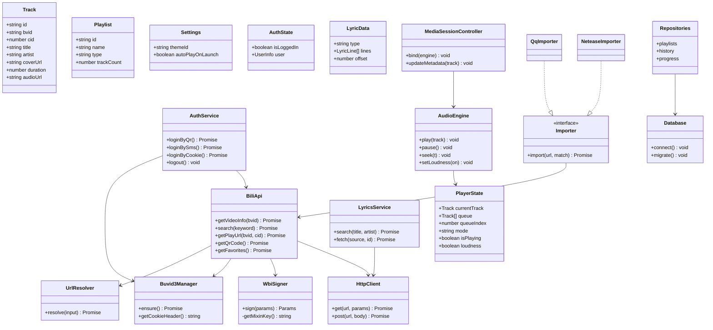
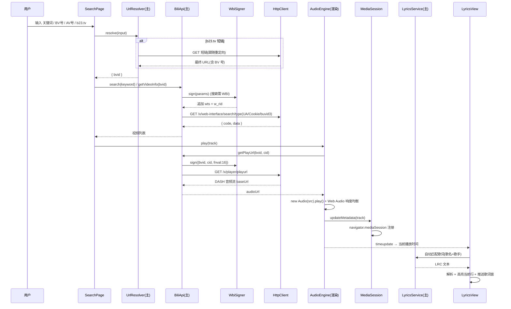
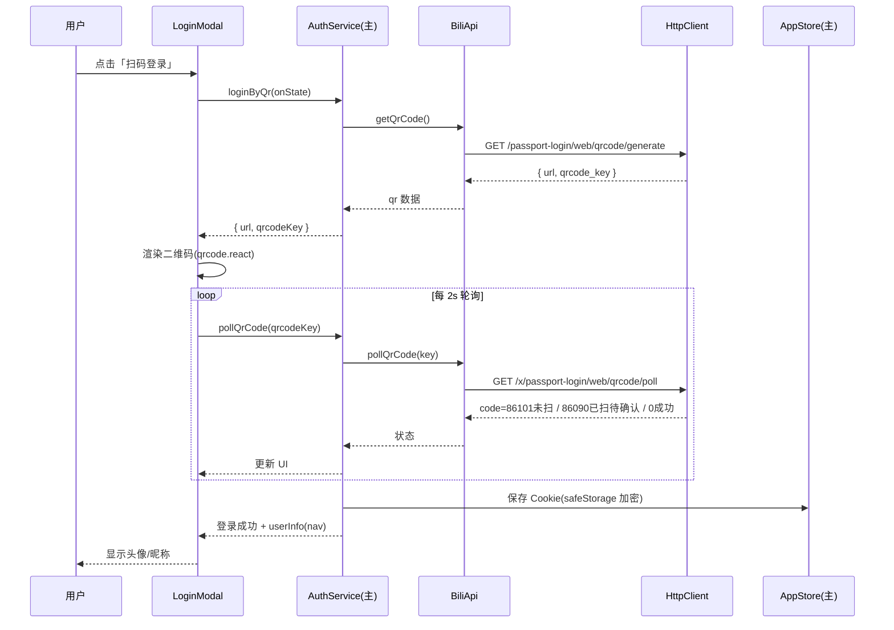
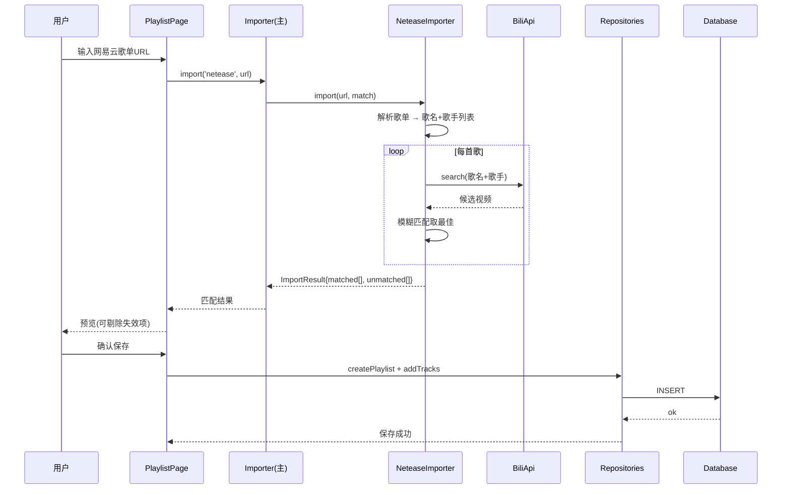
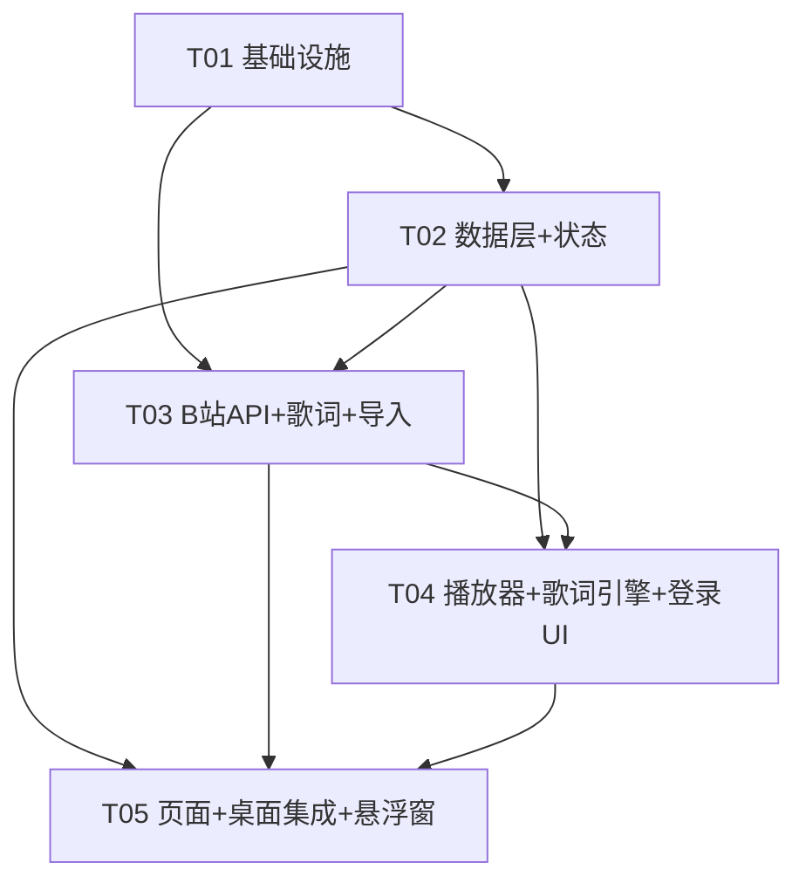

# BBPlayer Desktop 系统架构设计与任务分解

> 架构师：高见远（Gao）
> 上游输入：`docs/PRD.md`（产品经理已确认）
> 下游交付：工程师寇豆码的实现执行清单

---

## 0. 文档导读

本文档为 BBPlayer 桌面端（Windows / macOS / Linux）的完整架构设计与实现计划，包含 8 个部分：

| 章节 | 内容 | 目标读者 |
|---|---|---|
| 1 | 实现方案与框架选型（含理由） | 全体 |
| 2 | 目录结构 + 文件清单（精确到源文件） | 工程师 |
| 3 | 核心数据结构与接口定义（TS + 类图） | 工程师 |
| 4 | 程序调用流程（3 张时序图） | 工程师 |
| 5 | 任务列表（有序、含依赖、执行清单） | 工程师 |
| 6 | 依赖包列表（含版本建议） | 工程师 |
| 7 | 共享知识（跨文件约定） | 工程师 |
| 8 | 待明确事项 | 产品/主理人 |

---

## 1. 实现方案与框架选型

### 1.1 技术栈（最终敲定）

| 层 | 选型 | 版本建议 |
|---|---|---|
| 桌面壳 | **Electron** | ^31 |
| 构建 | **electron-vite** | ^2.3 |
| UI 框架 | **React 18** | ^18.3 |
| 语言 | **TypeScript** | ^5.5 |
| 样式 | **Tailwind CSS** | ^3.4 |
| 状态管理 | **Zustand** | ^4.5 |
| 数据请求 | **@tanstack/react-query** | ^5.51 |
| 本地持久化 | **better-sqlite3**（用户数据）+ **electron-store**（设置/会话） | ^11 / ^8.2 |
| 音频播放 | **原生 HTML5 Audio + Media Session API + Web Audio API** | 内置 |
| 路由 | **react-router-dom**（HashRouter） | ^6.26 |

### 1.2 选型理由（逐条论证）

**① Electron 而非 Tauri**
- **Media Session 系统媒体键原生支持**：Chromium 的 `navigator.mediaSession` 可注册 `play/pause/nexttrack/seekto` 等系统级媒体控制（Windows 音量弹窗、macOS 媒体键、耳机线控、蓝牙媒体键均直接可用），Tauri 的 WebView 无此能力，需要额外写各平台原生代码。
- **托盘 / 全局快捷键 / 无边框置顶窗口内置**：`Tray`、`globalShortcut`、`BrowserWindow({frame:false, alwaysOnTop:true})` 开箱即用，恰好覆盖 P1 的三大桌面能力。
- **Web Audio API 做响度均衡**：Chromium 提供完整 `AudioContext` / `AnalyserNode` / `DynamicsCompressorNode`，无需引入 FFmpeg，音质与性能可控。
- **TS 可复用原版 B 站 API 逻辑**：原版 BBPlayer 是 RN+TS，B 站 API/WBI 签名/解析逻辑可平移。
- **开发机已具备 Node 22**：可直接 `npm install && npm run dev` 构建验证，无交叉编译工具链负担（Tauri 需 Rust + 系统 WebView 依赖，CI/打包复杂度更高）。

**② electron-vite + React + TS + Tailwind**
- `electron-vite` 统一管理 main / preload / renderer 三端构建（开发热更新、多 renderer 入口支持歌词窗口），是当前 Electron+Vite 生态事实标准。
- Tailwind v3（暂不升 v4）配合 CSS 变量实现 B 站主题换肤，改动面最小。

**③ Zustand + react-query（与原版一致）**
- Zustand 管理播放器/歌单/设置等客户端状态；react-query 管理服务端（B 站 API）请求的缓存、去重、重试、轮询（扫码轮询天然适配）。
- 与原版技术心智一致，老逻辑可直接迁移。

**④ better-sqlite3 + electron-store 混合持久化（关键决策）**
- **better-sqlite3（主进程）**：歌单、歌单条目、播放历史、断点进度等**关系型、可能较大、需查询**的数据。同步 API、事务支持、无 ORM 复杂度。
- **electron-store（主进程）**：设置、窗口位置、上次会话上下文等**小而散的 KV**。JSON 可读、自动持久化。
- 两者均运行于主进程，渲染进程通过 IPC 访问，**数据库文件不暴露给渲染层**，安全且便于迁移。
- ⚠️ 版本注意：electron-store v9+ 为 ESM-only，与 electron-vite 默认 CJS 主进程有摩擦，**固定使用 `electron-store@^8.2.0`**（最后一个 CJS 版本）。

**⑤ 原生 HTML5 Audio + Media Session（桌面端无需 Media3/ExoPlayer）**
- 桌面端无 Android 后台播放/音频焦点问题，Chromium 的 `<audio>` 已足够；响度均衡用 Web Audio 图（MediaElementSource → Analyser → DynamicsCompressor → Gain → destination）实现。

### 1.3 核心架构模式

采用 **Electron 标准三层架构** + 前端 **Store / Component / Service 分层**：

```
┌─────────────────────────────────────────────────────┐
│  渲染进程 (renderer)                                  │
│  ┌───────────┐  ┌──────────────┐  ┌──────────────┐  │
│  │ Pages/UI  │→ │ Zustand Store │→ │ Service/API  │  │
│  │ Components│  │ react-query   │  │ client.ts    │  │
│  └───────────┘  └──────────────┘  └──────┬───────┘  │
│        audio-engine / media-session / lyrics-parser  │
└──────────────────────────────────────────┼──────────┘
                                           │ contextBridge (window.api)
┌──────────────────────────────────────────┼──────────┐
│  预加载 (preload/index.ts)  — 类型安全白名单 API     │
└──────────────────────────────────────────┼──────────┘
                                           │ IPC (invoke/handle, send/on)
┌──────────────────────────────────────────┼──────────┐
│  主进程 (main)                                        │
│  ┌──────────────┐ ┌──────────┐ ┌───────────────┐    │
│  │ bilibili/*   │ │ db/*     │ │ ipc/*         │    │
│  │ http/wbi/    │ │ SQLite   │ │ 处理器注册     │    │
│  │ api/auth/    │ │ store/*  │ │               │    │
│  │ lyrics/      │ │ electron-│ │               │    │
│  │ importer/    │ │ store    │ │               │    │
│  └──────────────┘ └──────────┘ └───────────────┘    │
│  window-manager / tray / global-shortcuts            │
└─────────────────────────────────────────────────────┘
```

**关键决策：所有 B 站/歌词/导入 HTTP 请求放在主进程**
- 主进程 Node 无 CORS 限制，Cookie/UA/风控头集中管理，Cookie 不出主进程。
- 渲染进程通过 `window.api.bili.*` 等 IPC 方法调用，react-query 的 `queryFn` 只做一层薄封装。这样 react-query 的缓存/轮询能力完整保留，网络层又安全可控。

---

## 2. 目录结构与文件清单

> 共约 60 个源文件（含配置，略超 50 估算，因 P0+P1 全量覆盖：3 种登录、WBI 签名、3 歌词源、双平台歌单导入、多窗口/托盘/快捷键）。如偏好更精简树，可合并「响度均衡入 audio-engine」「路由入 App」「会话并入 app-store」等（下文已按此合并）。

```
bbplayer-desktop/
├── package.json
├── electron.vite.config.ts
├── electron-builder.yml
├── tsconfig.json
├── tsconfig.node.json
├── tsconfig.web.json
├── tailwind.config.ts
├── postcss.config.js
├── .gitignore
├── resources/
│   └── icon.png                    # 应用/托盘图标（资源）
│
├── src/
│   ├── shared/                     # 主/渲染共享契约
│   │   ├── types.ts                # 全部领域类型
│   │   ├── constants.ts            # 常量/默认值/枚举
│   │   └── ipc.ts                  # IPC 通道名 + 请求响应类型映射
│   │
│   ├── main/                       # Electron 主进程
│   │   ├── index.ts                # 入口：生命周期/单实例锁
│   │   ├── window-manager.ts       # 主窗口 + 歌词窗口创建/联动
│   │   ├── tray.ts                 # 系统托盘 + 右键菜单
│   │   ├── global-shortcuts.ts     # 全局媒体快捷键
│   │   ├── db/
│   │   │   ├── database.ts         # SQLite 连接 + 建表迁移
│   │   │   └── repositories.ts     # 歌单/历史/进度 CRUD
│   │   ├── store/
│   │   │   └── app-store.ts        # electron-store：设置 + 会话上下文
│   │   ├── bilibili/
│   │   │   ├── http-client.ts      # 统一 HTTP 客户端（UA/Cookie/风控头）
│   │   │   ├── wbi-signer.ts       # WBI mixin key 混淆签名
│   │   │   ├── buvid3.ts           # buvid3 Cookie 生成/持久化
│   │   │   ├── url-resolver.ts     # BV/AV/b23.tv 解析
│   │   │   ├── api.ts              # B 站各 API 函数
│   │   │   └── auth.ts             # 登录态：扫码/短信/Cookie
│   │   ├── lyrics/
│   │   │   └── lyrics-service.ts   # LRC 自动匹配/搜索/抓取(网易云/QQ/酷狗)
│   │   ├── importer/
│   │   │   ├── index.ts            # Importer 接口 + 注册表
│   │   │   ├── netease.ts          # 网易云歌单导入
│   │   │   └── qq.ts               # QQ 音乐歌单导入
│   │   └── ipc/
│   │       ├── index.ts            # 中央注册 registerAllHandlers
│   │       ├── library.ts          # 数据 CRUD 处理器
│   │       ├── bilibili.ts         # B 站/歌词/导入 处理器
│   │       └── player.ts           # 播放控制转发处理器
│   │
│   ├── preload/
│   │   ├── index.ts                # contextBridge 暴露 window.api
│   │   └── index.d.ts              # window.api 类型声明
│   │
│   └── renderer/
│       ├── index.html              # 主窗口入口
│       ├── lyrics.html             # 歌词悬浮窗入口（第二 renderer）
│       └── src/
│           ├── main.tsx            # React 挂载
│           ├── App.tsx             # 根组件 + 路由(HashRouter)
│           ├── styles/globals.css  # Tailwind + CSS 变量(主题)
│           ├── api/
│           │   └── client.ts       # react-query 实例 + 查询 hooks 封装
│           ├── store/
│           │   ├── player-store.ts # 播放器状态
│           │   ├── library-store.ts# 歌单/列表状态
│           │   └── settings-store.ts# 设置镜像(与主进程同步)
│           ├── audio/
│           │   ├── audio-engine.ts # HTML5 Audio 引擎 + 响度均衡
│           │   └── media-session.ts# Media Session 集成
│           ├── lyrics/
│           │   └── lyrics-parser.ts# LRC/SPL 解析
│           ├── theme/
│           │   └── themes.ts       # B 站主题定义/应用
│           ├── components/
│           │   ├── Sidebar.tsx     # 左侧导航
│           │   ├── SearchBar.tsx   # 搜索框
│           │   ├── TrackList.tsx   # 歌曲列表
│           │   ├── PlayerBar.tsx   # 底部播放控制栏
│           │   ├── QueuePanel.tsx  # 播放队列面板
│           │   ├── LyricsView.tsx  # 主窗口歌词
│           │   ├── LoginModal.tsx  # 登录弹窗(扫码/短信/Cookie)
│           │   └── ui.tsx          # 通用 UI(Modal/Toast/ProgressBar)
│           ├── pages/
│           │   ├── HomePage.tsx    # 首页/推荐
│           │   ├── SearchPage.tsx  # 搜索
│           │   ├── PlaylistPage.tsx# 播放列表(本地/收藏/订阅/导入)
│           │   ├── HistoryPage.tsx # 播放历史
│           │   ├── SettingsPage.tsx# 设置
│           │   └── NowPlayingPage.tsx # 播放页(展开态)
│           └── lyrics/
│               ├── lyrics-main.tsx # 歌词窗口 React 入口
│               └── LyricsOverlay.tsx# 无边框悬浮歌词组件
```

---

## 3. 核心数据结构与接口定义

### 3.1 领域类型（`src/shared/types.ts`）

```ts
// —— 播放模式 ——
export type PlayMode = 'sequence' | 'loop-one' | 'loop-all' | 'shuffle';

// —— 播放项 ——
export interface Track {
  id: string;            // 全局唯一，= `${bvid}_${cid}` 或 uuid
  bvid: string;
  cid: number;
  aid?: number;
  title: string;
  artist: string;        // UP 主 / 歌手
  coverUrl: string;
  duration: number;      // 秒
  audioUrl?: string;     // DASH 音频流地址（运行时填充，有签名时效）
  source: TrackSource;   // 'local' | 'favorite' | 'subscription' | 'imported' | 'search'
  playlistId?: string;
}

export type TrackSource = 'local' | 'favorite' | 'subscription' | 'imported' | 'search';

// —— 歌单 ——
export interface Playlist {
  id: string;
  name: string;
  type: PlaylistType;    // 'local' | 'favorite' | 'subscription' | 'imported'
  sourceId?: string;     // 收藏夹 media_id / 合集 series_id / 导入源标识
  trackCount: number;
  createdAt: number;
  updatedAt: number;
}
export type PlaylistType = 'local' | 'favorite' | 'subscription' | 'imported';

// —— 播放历史 ——
export interface PlayHistoryEntry {
  trackId: string;
  bvid: string;
  cid: number;
  title: string;
  artist: string;
  coverUrl: string;
  playedAt: number;      // 时间戳
}

// —— 断点续播进度 ——
export interface PlaybackProgress {
  trackId: string;
  position: number;      // 秒
  duration: number;
  updatedAt: number;
}

// —— 播放器状态（Zustand）——
export interface PlayerState {
  currentTrack: Track | null;
  queue: Track[];
  queueIndex: number;
  mode: PlayMode;
  isPlaying: boolean;
  position: number;      // 秒
  duration: number;      // 秒
  volume: number;        // 0..1
  loudness: boolean;     // 响度均衡开关
}

// —— 设置 ——
export interface Settings {
  themeId: string;
  autoPlayOnLaunch: boolean;
  lyricOverlay: {
    alwaysOnTop: boolean;
    opacity: number;     // 0.1..1
    fontSize: number;    // px
    showRoman: boolean;
    showTranslation: boolean;
  };
  hotkeys: Record<string, string>;   // P2 自定义快捷键
}

// —— 会话上下文（启动自动播放）——
export interface SessionContext {
  lastTrackId?: string;
  lastPlaylistId?: string;
  lastQueue: Track[];
  lastQueueIndex: number;
  lastPosition: number;
  lastMode: PlayMode;
  savedAt: number;
}

// —— 登录态 ——
export interface AuthState {
  isLoggedIn: boolean;
  user: UserInfo | null;
}
export interface UserInfo {
  mid: number;
  name: string;
  face: string;
}

// —— 歌词 ——
export interface LyricWord {
  time: number;
  text: string;
}
export interface LyricLine {
  time: number;          // 秒
  text: string;
  words?: LyricWord[];   // SPL 逐字
  roman?: string;        // 罗马音
  translation?: string;
}
export interface LyricData {
  type: 'lrc' | 'spl';
  lines: LyricLine[];
  offset: number;        // 用户偏移（秒，可负）
  source: string;        // 'netease' | 'qq' | 'kugou' | 'manual'
}

// —— 歌词搜索候选 ——
export interface LyricCandidate {
  source: string;
  songId: string;
  title: string;
  artist: string;
}
```

### 3.2 IPC 契约（`src/shared/ipc.ts`）

```ts
// 通道名常量（渲染 invoke → 主 handle）
export const IPC = {
  // library（数据 CRUD）
  LibraryList: 'library:list',
  LibraryCreate: 'library:create',
  LibraryUpdate: 'library:update',
  LibraryDelete: 'library:delete',
  LibraryAddTracks: 'library:addTracks',
  LibraryRemoveTrack: 'library:removeTrack',
  LibraryListTracks: 'library:listTracks',
  LibrarySearch: 'library:search',
  HistoryAdd: 'history:add',
  HistoryList: 'history:list',
  ProgressSave: 'progress:save',
  ProgressGet: 'progress:get',
  // settings / session
  SettingsGet: 'settings:get',
  SettingsSet: 'settings:set',
  SessionGet: 'session:get',
  SessionSet: 'session:set',
  // bilibili
  BiliGetVideo: 'bili:getVideo',
  BiliSearch: 'bili:search',
  BiliPlayUrl: 'bili:playUrl',
  BiliResolve: 'bili:resolve',
  BiliQrGenerate: 'bili:qrGenerate',
  BiliQrPoll: 'bili:qrPoll',
  BiliSmsSend: 'bili:smsSend',
  BiliSmsLogin: 'bili:smsLogin',
  BiliCookieLogin: 'bili:cookieLogin',
  BiliLogout: 'bili:logout',
  BiliAuthState: 'bili:authState',
  BiliFavorites: 'bili:favorites',
  BiliSubscriptions: 'bili:subscriptions',
  // lyrics
  LyricsSearch: 'lyrics:search',
  LyricsFetch: 'lyrics:fetch',
  // importer
  Import: 'importer:import',
  // window / tray / player control（主 → 渲染 push）
  PlayerCommand: 'player:command',
  LyricsUpdate: 'lyrics:update',
} as const;

// 请求/响应类型映射（类型安全的关键）
export interface IpcRequestMap {
  [IPC.LibraryList]: { type?: PlaylistType };
  [IPC.BiliSearch]: { keyword: string; page?: number };
  [IPC.BiliPlayUrl]: { bvid: string; cid: number };
  [IPC.BiliResolve]: { input: string };
  [IPC.Import]: { source: 'netease' | 'qq'; url: string };
  // ... 其余以具体函数签名为准
}
```

### 3.3 主进程服务接口（核心类）

```ts
// —— HttpClient ——
class HttpClient {
  get<T>(url: string, params?: Record<string, unknown>, opts?: { wbi?: boolean }): Promise<T>;
  post<T>(url: string, body: unknown, opts?: { wbi?: boolean }): Promise<T>;
  request<T>(config: RequestConfig): Promise<T>; // 统一注入 UA/Referer/Origin/Cookie
}

// —— WbiSigner ——
class WbiSigner {
  private imgKey: string; private subKey: string;
  init(): Promise<void>;                       // 从 nav 接口取 wbi_img
  sign(params: Record<string, unknown>): Record<string, unknown>; // 追加 wts + w_rid
}

// —— Buvid3Manager ——
class Buvid3Manager {
  ensure(): Promise<string>;   // 无则调用 /x/frontend/finger/spi 生成并持久化
  getCookieHeader(): string;   // buvid3=xxx
}

// —— BiliApi ——
class BiliApi {
  getVideoInfo(bvid: string): Promise<VideoInfo>;
  search(keyword: string, page?: number): Promise<SearchResult>;
  getPlayUrl(bvid: string, cid: number): Promise<{ audioUrl: string; duration: number }>;
  getQrCode(): Promise<{ url: string; qrcodeKey: string }>;
  pollQrCode(qrcodeKey: string): Promise<QrPollResult>;
  getFavorites(): Promise<{ folders: FavoriteFolder[]; items: Track[] }>;
  getSubscriptions(): Promise<Track[]>;
  resolve(input: string): Promise<{ bvid: string }>;
}

// —— AuthService ——
class AuthService {
  loginByQr(onState: (s: QrState) => void): Promise<UserInfo>;
  loginBySms(phone: string, code: string): Promise<UserInfo>;
  loginByCookie(rawCookie: string): Promise<UserInfo>;
  logout(): Promise<void>;
  getState(): AuthState;
}

// —— Repositories ——
class Repositories {
  playlists: PlaylistRepository;
  history: HistoryRepository;
  progress: ProgressRepository;
}

// —— Importer 接口（可插拔，P1）——
interface Importer {
  readonly source: 'netease' | 'qq';
  import(playlistUrl: string, match: MatchFn): Promise<ImportResult>;
}
// MatchFn = (title, artist) => Promise<Track | null>  // 内部调用 BiliApi.search 做模糊匹配
```

### 3.4 类图




---

## 4. 程序调用流程（时序图）

### 4.1 搜索 → 解析 → 播放 → 歌词



### 4.2 登录扫码流程



### 4.3 外部歌单导入流程（P1）



---

## 5. 任务列表（工程师寇豆码的执行清单）

> 约定：按「层」分组，共 5 个任务（硬上限内）。依赖关系尽量扁平：T03/T04 仅依赖 T01+T02 可并行，T05 依赖 T02/T03/T04。`src/main/ipc/index.ts` 为中央注册器，由后续任务**增量扩展**（每新增一个 `ipc/xxx.ts`，在 index.ts 中追加一次 `registerXxx(ipcMain)`），此为唯一跨任务改动文件。

### T01 — 项目基础设施 + 主进程骨架（无依赖，P0）

**目标**：可启动空 Electron 应用，主窗口加载 React 页面，preload 桥接打通，共享类型/IPC 契约就位。

**源文件**：
- 配置：`package.json`、`electron.vite.config.ts`、`tsconfig.json`、`tsconfig.node.json`、`tsconfig.web.json`、`tailwind.config.ts`、`postcss.config.js`、`electron-builder.yml`、`.gitignore`
- 共享契约：`src/shared/types.ts`、`src/shared/constants.ts`、`src/shared/ipc.ts`
- 主进程：`src/main/index.ts`、`src/main/window-manager.ts`
- 预加载：`src/preload/index.ts`、`src/preload/index.d.ts`
- 渲染启动：`src/renderer/index.html`、`src/renderer/src/main.tsx`、`src/renderer/src/App.tsx`、`src/renderer/src/styles/globals.css`
- 资源：`resources/icon.png`

**要点/验收**：
1. `npm run dev` 可启动主窗口；`npm run build` 产出三端产物。
2. `types.ts` 定义第 3 节全部领域类型；`ipc.ts` 定义通道常量与类型映射。
3. `window-manager.ts` 提供 `createMainWindow()` / `createLyricsWindow()`（歌词窗口先建空壳，T05 填内容）。
4. preload 通过 `contextBridge.exposeInMainWorld('api', {})` 暴露空对象并带 `.d.ts` 类型，供后续任务填充。
5. `App.tsx` 挂载 HashRouter + 一个占位首页，验证渲染链路。

### T02 — 数据层 + 状态管理 + IPC 数据通道（依赖 T01，P0）

**目标**：SQLite/electron-store 持久化与 Zustand/react-query 状态层就绪，歌单/历史/进度/设置可读可写。

**源文件**：
- `src/main/db/database.ts`、`src/main/db/repositories.ts`
- `src/main/store/app-store.ts`
- `src/main/ipc/library.ts`、`src/main/ipc/index.ts`（初始注册 library）
- `src/renderer/src/api/client.ts`
- `src/renderer/src/store/library-store.ts`、`src/renderer/src/store/settings-store.ts`、`src/renderer/src/store/player-store.ts`

**要点/验收**：
1. `database.ts` 建表：`playlists(id,name,type,source_id,track_count,created_at,updated_at)`、`playlist_tracks(playlist_id,track_id,bvid,cid,title,artist,cover_url,duration,source,position)`、`play_history(...)`、`playback_progress(track_id,position,duration,updated_at)`。
2. `repositories.ts` 导出类型化 CRUD（增删改查歌单、增删条目、历史写入/查询、进度保存/读取）。
3. `app-store.ts` 用 electron-store 持久化 `Settings` 与 `SessionContext`（`settings:get/set`、`session:get/set`）。
4. `ipc/library.ts` 实现 `IPC.Library*/History*/Progress*/Settings*/Session*` 全部 handler；`ipc/index.ts` 提供 `registerAllHandlers()`。
5. 渲染侧三个 Zustand store + react-query `client.ts`（封装 `window.api.*` 为 queryFn）；`library-store` 能列出/创建/删除歌单并落库。

### T03 — B 站 API 层 + 歌词 + 歌单导入（依赖 T02，P0/P1）

**目标**：完整 B 站网络能力（WBI 签名、buvid3、短链解析、搜索、播放地址、登录接口）、歌词搜索抓取、可插拔歌单导入器，全部经 IPC 暴露。

**源文件**：
- `src/main/bilibili/http-client.ts`、`wbi-signer.ts`、`buvid3.ts`、`url-resolver.ts`、`api.ts`、`auth.ts`
- `src/main/lyrics/lyrics-service.ts`
- `src/main/importer/index.ts`、`netease.ts`、`qq.ts`
- `src/main/ipc/bilibili.ts`（并在 `ipc/index.ts` 追加注册）

**要点/验收**：
1. `http-client.ts`：Node fetch 统一注入 `User-Agent`(桌面 Chrome UA)、`Referer: https://www.bilibili.com/`、`Origin`、`Cookie`(buvid3 + SESSDATA)；处理 B 站 `code !== 0` 业务错误码并抛统一错误。
2. `wbi-signer.ts`：从 `nav` 接口取 `wbi_img.img_url/sub_url` 提取 key，按 mixinKeyEncTab 重排取前 32 位；`sign()` 追加 `wts` 并对排序后的参数做 URL 编码 + MD5 生成 `w_rid`。
3. `buvid3.ts`：无则调 `GET /x/frontend/finger/spi` 取 `b_3/b_4` 持久化到 app-store。
4. `api.ts`：`getVideoInfo`(`/x/web-interface/view?bvid=`)、`search`(`/x/web-interface/search/type?search_type=video`)、`getPlayUrl`(`/x/player/playurl`，参数 `bvid/cid/fnval=16/fnver=0`，取 `data.dash.audio[0].baseUrl`，无 dash 回退 `data.durl[0].url`)、`getFavorites`、`getSubscriptions`。
5. `url-resolver.ts`：正则识别 `BV[0-9A-Za-z]{10}` / `av\d+`；b23.tv 跟随重定向取最终 URL；AV 转 BV 走 `view?aid=`。
6. `auth.ts`：`loginByQr/loginBySms/loginByCookie/logout`，扫码用 `qrcode/generate` + `qrcode/poll`；Cookie 用 `nav` 校验后经 `safeStorage` 加密存储；通过 `bili:authState` 推送登录态变化。
7. `lyrics-service.ts`：`search`(网易云 `music.163.com/api/search/get` / QQ / 酷狗) + `fetch`(按 source+id 抓 LRC)。
8. `importer/index.ts` 定义 `Importer` 接口与注册表；`netease.ts`/`qq.ts` 实现「歌单解析 → 歌名+歌手 → BiliApi.search 模糊匹配」。
9. `ipc/bilibili.ts` 暴露上述全部方法，`client.ts` 增加对应 query hooks。

### T04 — 播放器 + 歌词引擎 + 登录 UI（依赖 T02、T03，P0）

**目标**：可实际播放音频、断点续播、响度均衡、系统媒体键、歌词解析与展示、登录弹窗。

**源文件**：
- `src/renderer/src/audio/audio-engine.ts`（含响度均衡）、`audio/media-session.ts`
- `src/renderer/src/lyrics/lyrics-parser.ts`
- `src/renderer/src/components/LoginModal.tsx`、`PlayerBar.tsx`、`TrackList.tsx`、`QueuePanel.tsx`、`LyricsView.tsx`

**要点/验收**：
1. `audio-engine.ts`：`play(track)` 先经 `getPlayUrl` 取流 → `Audio` 播放；`timeupdate` 写 player-store 并 `progress:save`（节流）；`ended` 按 mode 决定 next/loop/stop；Web Audio 图实现响度均衡开关（MediaElementSource → Analyser → DynamicsCompressor → Gain → destination）。
2. `media-session.ts`：注册 `navigator.mediaSession` 元数据与 `play/pause/previoustrack/nexttrack/seekto` 动作，绑定 player-store。
3. `lyrics-parser.ts`：解析标准 LRC `[mm:ss.xx]text`；SPL 逐字 `[mm:ss.xx]<mm:ss.xx>字`；支持 offset 平移与翻译/罗马音行。
4. `PlayerBar.tsx`：播放/暂停、上一首/下一首、循环(单曲/列表)、随机、进度拖拽、队列开关、响度开关；断点续播：切换歌曲时读取 `progress:get` 并 seek。
5. `QueuePanel.tsx`/`TrackList.tsx`：队列增删排序、列表点击播放、右键加入歌单。
6. `LyricsView.tsx`：当前行高亮滚动、偏移调整、手动搜索、粘贴 LRC。
7. `LoginModal.tsx`：三个 Tab（扫码=轮询+二维码、短信=手机号+验证码、Cookie=粘贴校验），成功后更新 authState 并解锁收藏/订阅入口。

### T05 — 页面/导航 + 主题 + 桌面集成 + 歌词悬浮窗（依赖 T02、T03、T04，P0/P1）

**目标**：完整 UI 信息架构落地 + 多窗口/托盘/全局快捷键/主题装扮，形成可发布产品。

**源文件**：
- `src/renderer/src/pages/HomePage.tsx`、`SearchPage.tsx`、`PlaylistPage.tsx`、`HistoryPage.tsx`、`SettingsPage.tsx`、`NowPlayingPage.tsx`
- `src/renderer/src/components/Sidebar.tsx`、`SearchBar.tsx`、`ui.tsx`
- `src/renderer/src/theme/themes.ts`
- `src/main/tray.ts`、`src/main/global-shortcuts.ts`、`src/main/ipc/player.ts`（并注册）
- `src/renderer/lyrics.html`、`src/renderer/src/lyrics/lyrics-main.tsx`、`LyricsOverlay.tsx`

**要点/验收**：
1. `App.tsx` 路由挂接 6 个页面；`Sidebar` 导航（首页/搜索/播放列表/历史/设置）。
2. `SearchPage`：智能搜索(BV/AV/b23 解析 + 关键词) + 收藏夹内搜索 + 本地列表内搜索（复用 `library:search`）。
3. `PlaylistPage`：本地歌单 CRUD、收藏夹/订阅合集转播放列表、外部歌单导入入口。
4. `themes.ts`：Theme 接口 + 内置 B 站主题（默认粉 + 可调 accent），通过 CSS 变量 + Tailwind 换肤；导航栏/进度条/头像框走主题化组件（开屏动画/点赞动画 P1 简化为内置动画）。
5. `tray.ts`：托盘菜单(播放/暂停、上/下一首、循环模式、响度、显隐歌词窗、显示主窗口、退出)；关闭主窗口默认最小化到托盘。
6. `global-shortcuts.ts` + `ipc/player.ts`：注册全局媒体键，`player:command` 从主进程推送到渲染层执行播放控制。
7. 歌词悬浮窗：无边框、置顶、可拖拽(`-webkit-app-region: drag`)、透明度/字号调节；主窗口经 `lyrics:update` 推送当前行到歌词窗口联动。

---

### 5.1 任务依赖图



---

## 6. 依赖包列表（含版本建议）

```
# 运行时核心
electron@^31.0.0                  # 桌面壳
react@^18.3.1                     # UI
react-dom@^18.3.1
react-router-dom@^6.26.0          # HashRouter 导航

# 状态与数据请求
zustand@^4.5.4                    # 客户端状态
@tanstack/react-query@^5.51.0     # 服务端状态/轮询

# 持久化（主进程）
better-sqlite3@^11.1.2            # 用户数据(SQLite)
electron-store@^8.2.0             # 设置/会话(注意:勿升 v9+ ESM)

# 工具
qrcode.react@^3.1.0               # 渲染登录二维码

# 构建工具链（devDependencies）
electron-vite@^2.3.0
vite@^5.4.0
@vitejs/plugin-react@^4.3.1
typescript@^5.5.4
tailwindcss@^3.4.10
postcss@^8.4.41
autoprefixer@^10.4.20
electron-builder@^24.13.3         # 打包 win/mac/linux
@types/node@^22.5.0
@types/react@^18.3.4
@types/react-dom@^18.3.0
@types/better-sqlite3@^7.6.11
```

> 说明：WBI 签名用 Node 内置 `crypto`(MD5) 实现，不额外引入 js-md5；音频用原生 HTML5 Audio + Web Audio，不引入 howler；歌词/HTTP 用 Node 内置 `fetch`，不引入 axios。

---

## 7. 共享知识（跨文件约定）

### 7.1 命名规范
- 文件：主进程/预加载/共享用 `kebab-case.ts`；React 组件用 `PascalCase.tsx`；store 用 `xxx-store.ts`。
- 接口：领域实体用名词（`Track`、`Playlist`）；响应用 `XxxResult`；请求参数用 `XxxParams`。
- 方法：查询 `getXxx/listXxx`，写入 `createXxx/updateXxx/deleteXxx/saveXxx`，IPC 通道用 `domain:action`（如 `library:create`）。

### 7.2 IPC 约定
- 渲染→主：`ipcRenderer.invoke(channel, payload)` ↔ `ipcMain.handle(channel, handler)`；主→渲染：`webContents.send` ↔ `ipcRenderer.on`。
- 所有通道名集中在 `src/shared/ipc.ts` 的 `IPC` 常量，禁止散落字符串。
- 所有 handler 统一返回 `Result<T>` 包装，避免「抛错 vs 返回 null」不一致：

```ts
export type Result<T> =
  | { ok: true; data: T }
  | { ok: false; error: { code: string; message: string } };
```

- `ipc/index.ts` 是唯一注册入口，新增领域处理器在对应 `ipc/xxx.ts` 导出 `registerXxx(ipcMain)` 并在此注册。

### 7.3 错误处理
- 网络层：B 站 `code !== 0` 抛 `BiliError(code, message)`；HTTP 非 2xx 抛 `HttpError(status, url)`。
- IPC 层：catch 后转 `Result` 的 `{ok:false,error}`，不向渲染层抛原始堆栈。
- UI 层：`ui.tsx` 的 `Toast` 统一展示错误；react-query 的 `onError` 钩子统一接入。

### 7.4 状态管理约定
- **player-store**：唯一播放真相源（currentTrack/queue/position/mode），audio-engine 只读写它，组件不直接操作 audio 元素。
- **library-store**：歌单/列表缓存，写操作后同时 `invalidateQueries` 刷新 react-query。
- **settings-store**：主进程 app-store 的渲染镜像，改动即 `settings:set` 回写。
- **服务端数据**（B 站搜索结果、收藏夹、歌词）一律走 react-query，不手动塞 Zustand。

### 7.5 路径与存储约定
- 数据根目录：`app.getPath('userData')`。
- SQLite 文件：`<userData>/bbplayer.db`；设置文件：`<userData>/settings.json`（electron-store 默认）。
- Cookie 经 `safeStorage.encryptString` 加密后存 app-store，明文不落盘、不进渲染进程。
- 时间统一存毫秒时间戳（`Date.now()`）；音频时长/进度用秒（number）。

### 7.6 B 站 API 关键事实（必须遵守）
- **WBI 签名**：`mixinKeyEncTab` 重排表固定为：
  `[46,47,18,2,53,8,23,32,15,50,10,31,58,3,45,35,27,43,5,49,33,9,42,19,29,28,14,39,12,38,41,13,37,48,7,16,24,55,40,61,26,17,0,1,60,51,30,4,22,25,54,21,56,59,6,63,57,62,11,36,20,34,44,52]`（标准表，实现时以 nav 接口实际返回校验）。
- `getMixinKey = 表.map(i => imgKey+subKey[i]).join('').slice(0,32)`；签名流程：加 `wts` → 按键排序 → 过滤 `!'()*` 的 URL 编码 → 拼接 mixinKey → MD5 得 `w_rid`。
- **buvid3**：`GET /x/frontend/finger/spi` → `b_3`，作为 `buvid3` Cookie 持久化，所有请求携带。
- **播放地址**：先 `view?bvid=` 取 `cid`；再 `playurl` 传 `bvid/cid/fnval=16/fnver=0`，音频取 `data.dash.audio[0].baseUrl`，无 dash 回退 `data.durl[0].url`。
- **短链**：b23.tv 直接 GET 跟随 302 取最终 URL，正则提取 BV 号。
- 搜索/playurl 需 WBI 签名 + 有效 buvid3；`view` 可免签名。

---

## 8. 待明确事项（请产品/主理人确认）

1. **短信登录风控**：B 站短信登录实际需 geetest 人机验证，MVP 是否降级为「扫码 + Cookie」为主、短信做占位（预留接口）？
2. **多账号**：是否需多账号切换？（当前设计为单账号登录态，含登出）
3. **歌词悬浮窗多显示器**：是否需记忆所在屏幕/位置（当前：置顶 + 可拖拽 + 保存位置，不主动跨屏跟随）。
4. **「任意 B 站主题装扮」深度**：B 站官方「装扮」为付费皮肤体系，桌面端是否先做「内置主题集 + 自定义强调色」，官方装扮导入列为后续？（当前按此落地）
5. **外部歌单导入合规**：网易云/QQ 抓取涉及第三方平台，是否内置「仅匹配已有视频、跳过失效项」容错与免责提示？（当前按此实现）
6. **发布格式与签名**：Windows（NSIS 安装包 + 免安装）、macOS（签名/公证）、Linux（AppImage/deb）的优先级与自动更新（electron-updater）是否纳入 MVP？（当前 electron-builder 预留，未含自动更新）
7. **全局媒体键与 Media Session 冲突**：macOS 媒体键监听需辅助功能权限，是否接受「Media Session 优先、全局快捷键作为兜底」的双通道策略？（当前按此）

---

*本文档为架构设计与任务分解，供工程师寇豆码按 T01→T05 顺序实现。*
